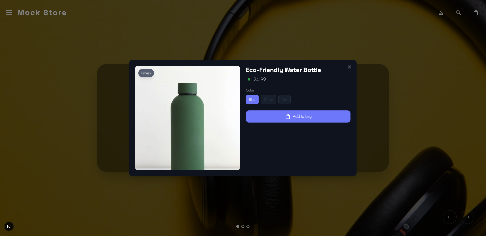

# Building a Truly Modern React Storefront  

## Advanced React Architecture in a Production-Ready Shopify UI

This is the local version of the article about this project that was published on the huement.com blog. It explores how a modern React + Next.js storefront leverages the newest React patterns and architecture to deliver an interactive, accessible, animation-rich ecommerce experience.

Instead of discussing React in theory, we examine real production components:

- Root Layout
- Product Grid
- Quick View Modal
- Featured Hero Slider

Each demonstrates modern React concepts including JSX, client/server boundaries, hooks, component composition, portals, context, animation orchestration, and accessibility-driven UI design.

---

# Part 1 — Core React Concepts Used Throughout the Storefront

Before diving into the code, here is a quick overview of the React features used across the project.

## JSX
JSX is a declarative syntax extension that allows developers to describe UI structures using JavaScript. Instead of manually manipulating the DOM, React components return UI descriptions.

**Benefits**:
- Highly readable UI structure
- Easy conditional rendering
- Seamless integration with logic

## Functional Components
Modern React shifted the paradigm from **Class Components** (which act like blueprints for objects) to **Functional Components** (which act like pure JavaScript functions). This isn't just a syntax preference; it changed the entire architecture of frontend development.
Here is an expansion on why this shift occurred and how it benefits your codebase:

### 1. The Death of Boilerplate
Class components required a significant amount of "ceremony." To manage a simple piece of state, you had to define a constructor, call super(props), and explicitly bind event handlers to the this keyword.
Functional components eliminate this. A function simply accepts props as an argument and returns JSX. This results in:
* **Reduced file size:** Less code to write and maintain.
* **Easier Readability:** The logic flows top-to-bottom without jumping between constructor, render, and lifecycle methods.

### 2. Composable Logic with Hooks
In Class components, logic was organized by **lifecycle methods** (e.g., `componentDidMount`, `componentDidUpdate`). This often meant that related code (like setting up and tearing down a subscription) was split across two different functions, while unrelated code was crammed into one.
**Hooks (like** useState **and** useEffect**)** allow you to group logic by **feature** rather than lifecycle timing.
* **Custom Hooks:** You can extract stateful logic into a standalone function (e.g., useWindowSize()) and reuse it across multiple components. This level of composition was extremely difficult and clunky with "Higher-Order Components" or "Render Props" in the class era.

### 3. Predictable Data Flow and "Capture Value"
Functional components use the concept of **closures**. When a functional component renders, it "captures" the props and state at that specific moment in time.
In Class components, `this.props` is mutable; React mutates it behind the scenes so you can read the latest version in the render method. This could lead to bugs where a callback (like a `setTimeout`) reads the *new* props instead of the ones that existed when the function was actually triggered. Functional components ensure that what the user sees is always in sync with the state of that specific render.

### 4. Performance and Tooling
Modern React features and external tools are optimized for functions:
* **Minification:** JavaScript minifiers (like Terser) can mangle function and variable names much more effectively than they can minify Class methods.
* **Tree Shaking:** Functions are easier for compilers to analyze, helping remove unused code from your final bundle.
* **Concurrent Rendering:** Features like `useTransition` and `useDeferredValue` are designed specifically around the functional paradigm to keep the UI responsive during heavy updates.

### Summary Table: Class vs. Functional
| **Feature**        | **Class Components [OLD]**         | **Functional Components [NEW]**     |
|--------------------|------------------------------------|-------------------------------------|
| **State**          | this.state / this.setState         | useState Hook                       |
| **Logic Reuse**    | HOCs, Render Props                 | Custom Hooks                        |
| **Lifecycle**      | componentDidMount, etc.            | useEffect Hook                      |
| **Complexity**     | High (due to this context)         | Low (pure JavaScript functions)     |
| **Logic Grouping** | Logic grouped by time (Lifecycle). | Logic grouped by concern (Feature). |

### 5. EXAMPLE
To illustrate the shift, let’s look at a common scenario: a component that tracks a window's width and manages a simple counter.
In the Class version, the logic for the window listener is split across three different lifecycle methods, making it hard to track. In the Functional version, useEffect keeps the "setup" and "cleanup" together.

#### LEGACY CLASS COMPONENT

```javascript
import React, { Component } from 'react';

class ResizeCounter extends Component {
  constructor(props) {
    super(props);
    this.state = { count: 0, width: window.innerWidth };
    // Manual binding required for 'this'
    this.handleResize = this.handleResize.bind(this);
  }

  componentDidMount() {
    // Side effect setup
    window.addEventListener('resize', this.handleResize);
    document.title = `Count: ${this.state.count}`;
  }

  componentDidUpdate(prevProps, prevState) {
    // Check if count changed to update title
    if (prevState.count !== this.state.count) {
      document.title = `Count: ${this.state.count}`;
    }
  }

  componentWillUnmount() {
    // Side effect cleanup
    window.removeEventListener('resize', this.handleResize);
  }

  handleResize() {
    this.setState({ width: window.innerWidth });
  }

  render() {
    return (
      <div>
        <p>Window width: {this.state.width}</p>
        <button onClick={() => this.setState({ count: this.state.count + 1 })}>
          Increment: {this.state.count}
        </button>
      </div>
    );
  }
}
```

#### MODERN CLASS COMPONENT

```javascript
import React, { useState, useEffect } from 'react';

const ResizeCounter = () => {
  const [count, setCount] = useState(0);
  const [width, setWidth] = useState(window.innerWidth);

  // Concern 1: Window Resize Logic
  useEffect(() => {
    const handleResize = () => setWidth(window.innerWidth);
    window.addEventListener('resize', handleResize);
    
    // Cleanup is returned in the same block!
    return () => window.removeEventListener('resize', handleResize);
  }, []); // Empty array = run on mount only

  // Concern 2: Document Title Logic
  useEffect(() => {
    document.title = `Count: ${count}`;
  }, [count]); // Runs only when count changes

  return (
    <div>
      <p>Window width: {width}</p>
      <button onClick={() => setCount(count + 1)}>
        Increment: {count}
      </button>
    </div>
  );
};
```


**Benefits**:
- Cleaner mental model
- Easier testing
- Improved composability

## Hooks
Hooks enable stateful logic inside functional components.

Examples used in this project:
- `useState`
- `useEffect`
- `useRef`
- `useCallback`

**Benefits**:
- Encapsulated side effects
- Reactive UI updates
- Cleaner lifecycle management

## Props and Unidirectional Data Flow
Data and callbacks move from parent components to child components via props.

**Benefits**:
- Predictable rendering
- Easier debugging
- Clear data ownership

## Component Composition
Instead of large monolithic UI structures, the storefront is built from small reusable components combined together.

**Benefits**:
- Scalable architecture
- Improved code reuse
- Better separation of concerns

## Conditional Rendering
React uses standard JavaScript expressions to render UI dynamically.

**Benefits**:
- Clear fallback states
- Adaptive UI behavior
- Minimal templating complexity

## Lists and Keys
Dynamic lists use `.map()` and stable keys to enable efficient reconciliation.

**Benefits**:
- Optimized rendering
- State preservation
- Minimal DOM updates

## Refs
Refs allow direct DOM access when necessary.

**Used for**:
- Focus management
- Accessibility workflows
- Portal interaction

## Context API
React context shares state globally without prop drilling.

**Used for**:
- Cart state
- Cross-component data access

## Portals
Portals render components outside the normal DOM hierarchy.

**Used for**:
- Modals
- Overlays
- Global UI layers

## Client vs Server Components (Next.js App Router)
Next.js allows components to run on the server by default. Interactive components declare `"use client"` to enable hooks and browser APIs.

**Benefits**:
- Faster initial rendering
- Reduced JavaScript payload
- Improved SEO and performance

---

# Part 2 — Root Layout: Server Components and Global Architecture

## The Root Layout demonstrates modern React server-driven architecture

The Root Layout is more than just a wrapper around pages — it acts as the foundation that defines how rendering flows through the entire application. Instead of pushing everything to the client and letting the browser figure it out, the layout establishes a server-first pipeline where content is prepared, optimized, and streamed to users quickly.

In practice, this means the layout becomes responsible for global structure, shared UI, and performance decisions that affect every route in the app.

## Server Component Structure

The layout is intentionally not marked with "use client", which means it runs as a Server Component by default. Most of the rendering work happens on the server before the browser ever sees the page.

This changes how you think about building interfaces. Instead of asking "how do I hydrate this later?", you start asking "does this even need to run on the client at all?"

Benefits:

- Reduced client-side JavaScript and smaller bundles
- Faster initial page loads and improved Core Web Vitals
- Streaming-friendly rendering for progressive content delivery
- Server-side data fetching without additional client requests
- Ability to keep sensitive logic and tokens off the client
- A stable application shell that loads instantly across routes

## What the Root Layout Typically Owns

Because it runs on the server, the Root Layout becomes the ideal place for global concerns:

- Navigation and persistent layout structure
- Font loading and global styling
- Metadata, SEO tags, and document structure
- Theme setup and global providers that do not require client interactivity
- High-level data required across multiple pages

## Real-World Impact on the Storefront

Using a server-driven Root Layout makes the storefront feel faster and more stable:

- Users see meaningful content immediately instead of a blank loading shell
- Layout shifts are reduced because structural HTML arrives early
- Hydration work is minimized since fewer components require client logic
- Navigation feels instant because the global shell is already rendered

## Why This Matters in Modern React

Modern React encourages developers to move as much work as possible to the server while reserving the client for true interactivity. The Root Layout becomes the boundary where these decisions are made.

By keeping the layout server-first, the application gains:

- A consistent performance baseline
- Cleaner separation between server and client responsibilities
- Reduced complexity in interactive components
- A more scalable architectural foundation

Instead of being a passive container, the Root Layout becomes an active performance and architecture layer that helps the entire application stay fast, maintainable, and predictable.

## Server Component Structure

The layout is not marked with `"use client"`, meaning it runs as a server component.

**Benefits**:
- Reduced client-side JavaScript
- Faster page loads
- Streaming-friendly rendering

```tsx
export default function RootLayout({ children }: { children: React.ReactNode }) {

	// Children are passed into the layout:
	<CartProvider>{children}</CartProvider>

}
```

This demonstrates React’s composition model — the layout provides global UI structure while individual pages inject their own content.

## Context API for Global State
The `CartProvider` uses React Context to share cart state across the entire app.

**Why this matters**:
* **Eliminates prop drilling**
* Enables global reactive updates
* Keeps state centralized

### Font Loading with React and Next.js
Fonts are defined declaratively:
```
const spaceGrotesk = Space_Grotesk({...});
```

**Benefits**:
* Automatic optimization
* Reduced layout shift
* Server-driven styling

### Metadata as Structured UI Configuration
React components define metadata:
```
export const metadata: Metadata = { ... }
```
This allows the UI to remain declarative even at the document level.


# Part 3 — Quick View Modal: Advanced React Interaction Patterns

The `QuickViewModal` component is more than a UI container; it is the critical bridge between browsing and purchasing. In e-commerce, every millisecond of friction between a "Quick View" click and the "Add to Cart" button costs money. This component serves as the "heart and soul" of the application, designed specifically to walk the user down the path to a conversion with zero lag.

## 3A. Portals: Escaping the DOM Hierarchy
```javascript
if (typeof document === "undefined") return null;
return createPortal(modal, document.body);
```

**Why it matters for conversion:** In complex storefront layouts, stacking contexts (z-index battles) can often cause modals to be clipped by parent containers or hidden behind sticky headers. By using createPortal, we teleport the modal to the very top of the document.body.

* **The Result:** Guaranteed visual priority. The "Call to Action" is never obscured by legacy layout constraints, ensuring the user's focus remains entirely on the product and the "Add to Cart" workflow.

## 3B. High-Fidelity Physics with Framer Motion
The modal utilizes AnimatePresence and motion to move away from rigid CSS transitions toward fluid, physics-based motion.

```javascript
transition={{ layout: { type: "spring", damping: 25, stiffness: 300 } }}
```

* **Spring Physics:** Unlike standard linear easing, spring physics feel "snappy" and organic. It makes the UI feel responsive to the touch, which builds a sense of quality and trust.
* **Layout Orchestration:** The layout prop allows the modal to animate its size changes automatically if the product description expands or options change, preventing jarring layout shifts that can frustrate users.

## 3C. State-Driven Adaptive UI (Header Compaction)
The modal tracks its own internal scroll state to trigger a headerCompact mode.

```javascript
const [headerCompact, setHeaderCompact] = useState(false);

// Triggered via onScroll={handleScroll} on the container
const handleScroll = (e) => {
  if (e.currentTarget.scrollTop > 10) {
    setHeaderCompact(true);
  } else {
    setHeaderCompact(false);
  }
};
```

* **Contextual Intelligence:** As the user scrolls down to read reviews or details, the header shrinks. This maximizes the available "real estate" for the product content and the "Add to Cart" button, keeping the most important information front-and-center.

## 3D. Accessibility as a Conversion Tool
Accessibility is often mistaken for a "compliance" task, but in this modal, it is a performance feature that helps different types of users stay in the funnel.
* **Focus Management:** Through useRef, the component can programmatically move focus to the close button or the product title upon opening. This ensures keyboard users aren't "lost" in the background.
* **Reduced Motion Support:** ```javascript const [reduceMotion, setReduceMotion] = useState( () => typeof window !== "undefined" && window.matchMedia("(prefers-reduced-motion: reduce)").matches );

By respecting system preferences, we ensure that users prone to motion sickness have a comfortable experience, preventing them from bouncing off the site due to discomfort.

 ## 3E. Touch Optimization and Ergonomics 
The mobile implementation is specifically tuned for the "thumb zone." 
* **Ergonomic Tap Targets:** The mobile close button uses `touch-manipulation` and a `min-h-[44px]` (the industry standard for tap targets). 
* **Responsive Positioning:** Using `items-end sm:items-center`, the modal slides up from the bottom on mobile (like a native sheet) but centers on desktop. This matches user expectations for each device, making the "Close" and "Add to Cart" actions feel native and intuitive.

### Summary of Interaction Gains

| Feature | Technical Implementation | Impact on User | 
| :--- | :--- | :--- | 
| **Instant Feel** | Framer Motion Spring | Eliminates perceived lag; feels high-end. | 
| **Maximized Content** | Scroll-driven `headerCompact` | Keeps the product options visible longer. |
| **Clean Exit** | `AnimatePresence` | Smooth exit prevents "flashing" or jarring jumps. | 
| **Zero Stacking Issues** | React Portals | Prevents UI bugs where the modal is unclickable. |

By combining these patterns, the `QuickViewModal` creates a "slippery slope" that leads the user from interest to action with zero technical friction.


## The QuickView Engine: Powering Premium Interactions 

To build a storefront that feels "high-end," we move beyond basic HTML. By using the `"use client"` directive, we unlock the full suite of modern React capabilities: **Hooks**, **Event Listeners**, **Physics Engines**, and direct **DOM Manipulation**. 

### 1. Reactive UI State (`useState`) 
Instead of manually toggling CSS classes, we let state drive the visual experience. 

```javascript 
const [headerCompact, setHeaderCompact] = useState(false);
```

* **How it works:** As the user scrolls through product details, the header dynamically shrinks.
* **The Payoff:** The UI feels alive and responsive. Logic remains declarative and easy to debug.

### 2. Smart Side Effects (useEffect)
We use useEffect to synchronize our component with the "outside world"—the browser itself.
```javascript
useEffect(() => { window.addEventListener("keydown", handleEscape); return () => window.removeEventListener("keydown", handleEscape); }, [handleEscape]);
```

* **Real-World Use:** Handling "Esc" key closures, locking the background scroll when the modal is open, and detecting if a user prefers "Reduced Motion" at the system level.
* **The Payoff:** Predictable behavior that replaces messy, legacy lifecycle methods.

### 3. Surgical DOM Access (useRef)
Sometimes, you need to grab a specific element directly. useRef provides a "laser pointer" to the DOM.
```javascript
const contentRef = useRef<HTMLDivElement>(null);
```

* **The Mission:** Primarily used for **Focus Trapping**. When the modal opens, we force the keyboard focus inside it.
* **The Payoff:** Seamless accessibility (WCAG) and flawless keyboard navigation.

### 4. Performance Optimization (useCallback)
In a high-traffic store, performance is profit. useCallback ensures our functions don't get "re-created" every time the screen updates.
```javascript
const handleEscape = useCallback((e: KeyboardEvent) => {...}, []);
```

* **The Payoff:** Prevents expensive re-renders and keeps the application buttery smooth, even on low-end mobile devices.

### 5. Teleporting Content (createPortal)
Modals often get "trapped" inside parent containers with weird CSS rules. Portals allow us to "teleport" the modal to the very top of the HTML structure.
```javascript
return createPortal(modal, document.body);
```

* **The Payoff:** No more z-index wars. The modal always sits on top, escaping the "layout stacking context" of the rest of the page.

### 6. Meaningful Motion (AnimatePresence)
Standard "on/off" visibility is jarring. We use AnimatePresence to manage the lifecycle of a component as it enters and leaves the page.
```javascript
{isOpen && ( <motion.div> ... </motion.div> )}
```

* **The Payoff:** Professional-grade "exit animations." The modal doesn't just vanish; it fades or slides away gracefully, maintaining the user's spatial awareness.

### BONUS POINTS | Featured Slider: Architecture in Motion
The `FeaturedSlider` isn't just a carousel; it’s a masterclass in combining third-party power (like Swiper.js) with React’s declarative architecture. It handles complex state—active indices, touch gestures, and autoplay—while keeping the UI perfectly synced with the underlying product data.

Without going into to much detail, the swiper is awesome because the library that we are using is awesome:

```javascript
import { Swiper, SwiperSlide } from "swiper/react";
import { Navigation, Pagination, Autoplay, EffectFade } from "swiper/modules";
import { motion, AnimatePresence } from "motion/react";
import "swiper/css";
import "swiper/css/navigation";
import "swiper/css/pagination";
import "swiper/css/effect-fade";
```

## Part 4 — Product Grid: Component Composition and Declarative Lists
The product grid showcases how React handles scalable product interfaces.

### Component Composition
The grid renders reusable `ProductCard` components:

```
products.map(product => <ProductCard ... />)
```

**Benefits**:

* Modular UI
* Independent component logic
* Scalable architecture
* Event Prefetching and Interaction Handling

```
onMouseEnter={handlePrefetch}
onFocus={handlePrefetch}
```

React’s event system enables performance optimizations such as prefetching.

### Derived UI Values

**Instead of state**:

```
const category = getPrimaryCategory(product);
```
```
```

**Derived data ensures**:

* Deterministic rendering
* Minimal re-renders
* Cleaner logic
* Accessibility via Refs
* Refs allow focus restoration when modals close.

**Benefits**:
* Improved keyboard navigation
* Screen reader compatibility
* WCAG compliance
* Why Modern React Enables a Truly Great Storefront]

This storefront demonstrates how modern React architecture supports:

* Server-first rendering for performance
* Client-side interactivity where needed
* Declarative animation systems
* Accessibility-driven UI design
* Component-based scalability
* Predictable data flow
* Reactive UI updates

By combining hooks, context, portals, JSX, and compositional design patterns, the application achieves a level of responsiveness and maintainability that traditional frontend architectures struggle to match.

# Final Thoughts
Modern React is no longer just a UI library — it is a full architectural paradigm for building interactive applications.
This storefront leverages:

* Server components for performance
* Client components for interactivity
* Hooks for state and lifecycle control
* Context for global data
* Portals for layered UI
* Declarative animations
* Accessible interaction models

The result is a highly responsive, animation-rich, and accessible Shopify storefront that demonstrates how the latest React features can power production-grade ecommerce experiences.

In future sections, we will explore:

* Data fetching strategies with GraphQL
* Motion-driven microinteractions
* Accessibility-first animation systems
* Performance optimizations using React’s rendering model
* View transitions and shared element animations

Together, these patterns show how modern React enables developers to build storefronts that feel fast, polished, and deeply interactive without sacrificing maintainability or accessibility.
