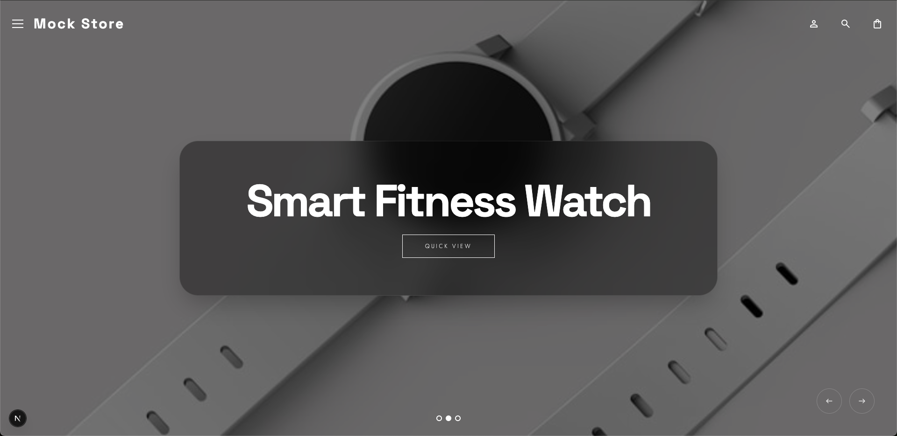

# Shopify Storefront API Demo


## Overview



This project is a modern Shopify Storefront API demo built with Next.js, React, TypeScript, TailwindCSS, and Motion. It showcases how to create a polished, animation-forward headless storefront experience using real Shopify product data while maintaining strong accessibility, performance, and responsive design principles.

The goal of this demo is to highlight practical storefront architecture patterns, thoughtful UI/UX decisions, and production-level frontend implementation strategies — not to serve as a full ecommerce platform.

The project includes a fully functional Quick View modal workflow, advanced motion design, accessibility-focused interaction handling, and a variety of UI components commonly found in modern ecommerce sites.

A local mock API is also included so the project can be tested without requiring a Shopify developer account.

---

## Why These Technologies and Features Were Used

### Next.js
Next.js provides hybrid rendering capabilities, routing, and performance optimizations that make it ideal for headless commerce frontends. Server components and API routes allow flexible integration with Shopify while maintaining fast page loads and SEO-friendly rendering.

### TypeScript
TypeScript enforces strong typing across Shopify API responses, UI state, and component interfaces. This reduces runtime errors, improves maintainability, and ensures predictable data handling throughout the application.

### TailwindCSS
TailwindCSS enables a consistent design system with rapid iteration while keeping styling scalable and maintainable. Utility-first classes also help keep layout and responsive behavior easy to reason about.

### Motion / Framer Motion
Motion is used to create smooth transitions, subtle microinteractions, and cohesive UI animations. It improves perceived performance, enhances product interaction flows, and helps create a modern and polished storefront experience.

### Shopify Storefront GraphQL API
GraphQL provides precise data fetching and efficient queries for products, variants, pricing, and media. This allows the frontend to request only the data required for each interaction, reducing unnecessary payload size and improving performance.

### Reduced Motion and Mobile Accessibility
The UI respects `prefers-reduced-motion` and adapts animations for users who prefer minimal motion. On mobile devices, interactions prioritize clarity, readability, and reduced cognitive load. Motion effects are scaled back or simplified to improve usability and performance on smaller screens.

### Local Mock API
A built-in local testing API returns static product data. This allows developers to run and explore the project without Shopify credentials, making onboarding faster and enabling UI experimentation without relying on external services.

---

## Core Features Implemented

### Storefront Data Integration
- Fetches product listings from a Shopify collection
- GraphQL-based product detail queries
- Strongly typed Shopify data models
- Prefetching product data on hover/focus
- Abort handling for rapid modal switching
- Local mock API for development without Shopify

### Product Listing
- Responsive product grid
- Product cards with image, title, and price
- Quick View modal triggers
- Animated UI transitions and hover states

### Quick View Modal
- Accessible modal semantics with focus management
- Close via escape key, backdrop, or close button
- Background scroll locking
- Loading skeleton state
- Desktop two-column layout
- Mobile stacked layout
- Route-based modal state
- Shared element image transitions
- Motion entrance and exit animations

### Variant Selection
- Dynamic option selection UI
- Selected variant resolution logic
- Disabled unavailable options
- Variant-based image updates
- Dynamic pricing updates
- Keyboard navigation support
- Accessible control behaviors

### Add to Bag Simulation
- Deterministic async simulation
- Loading and success states
- Animated CTA feedback
- Disabled CTA until valid variant selected
- Consistent modal reset behavior

---

## Additional UI and Interaction Features

- Ken Burns effect animated header
- Frosted glass banner overlay
- Sticky navigation header
- Cart modal
- User account modal
- Animated site links menu
- Animated footer
- Google Material Icons integration
- Sticky mobile CTA bar
- Thumbnail gallery with animated selection
- Price and layout animation transitions
- Reduced motion support
- Animated microinteractions across UI elements

---

## Accessibility and UX Considerations

- Focus trapping and restoration in modal workflows
- Keyboard navigation for product options
- Semantic dialog roles and ARIA attributes
- Reduced motion preferences respected
- Mobile-first responsive layouts
- Visual hierarchy and readable spacing
- Consistent animation timing and feedback states

---

## Local Development and Testing

This project supports two modes:

1. Shopify Storefront API Mode
   - Uses real Shopify product data
   - Requires environment variables

2. Local Mock API Mode
   - Uses static test data
   - No Shopify account required
   - Ideal for UI experimentation and onboarding

---

## SHOPIFY API OR LOCAL JSON

Depending on what way you go about creating a `.env.local` file will determine if this uses a real Shopify API endpoint, or if it is going to use a local json file that will return static data. 

```
# USE API
SHOPIFY_STOREFRONT_PRIVATE_ACCESS_TOKEN="*******************************"
NEXT_PUBLIC_SHOPIFY_STORE_NAME="shop-name"
NEXT_PUBLIC_SHOPIFY_STOREFRONT_API_VERSION="2025-10"
```

```
# Enable mock Shopify API (set to "true" to use mock data, "false" to use real Shopify API)
USE_MOCK_SHOPIFY=true

# Mock mode doesn't require real Shopify credentials, but we need them defined for the env validation
SHOPIFY_STOREFRONT_PRIVATE_ACCESS_TOKEN=mock-token
NEXT_PUBLIC_SHOPIFY_STORE_NAME=mock-store
NEXT_PUBLIC_SHOPIFY_STOREFRONT_API_VERSION=2025-07
NEXT_PUBLIC_SHOPIFY_COLLECTION_HANDLE=frontpage
```

---

## Scripts

```
pnpm dev # Start development server
pnpm build # Build production bundle
pnpm start # Run production build
pnpm codegen # Generate Shopify GraphQL types
pnpm lint # Run ESLint
pnpm list-collections # List Shopify collections
pnpm list-collection-items # Inspect collection items
```


---

## Project Goals

This demo focuses on:

- Demonstrating real-world Shopify Storefront API usage
- Building accessible and animation-forward ecommerce UI
- Maintaining strong state management and type safety
- Delivering polished motion interactions without sacrificing usability
- Supporting mobile performance and reduced-motion users
- Providing a production-ready architecture example for headless storefront development

---

## Notes

- This is a frontend demo and does not implement a full ecommerce checkout flow.
- Add-to-cart behavior is simulated for demonstration purposes.
- The local mock API allows testing UI and interactions without external dependencies.
- Designed to emphasize modern UI patterns, animation design, and accessibility-conscious development.

---
